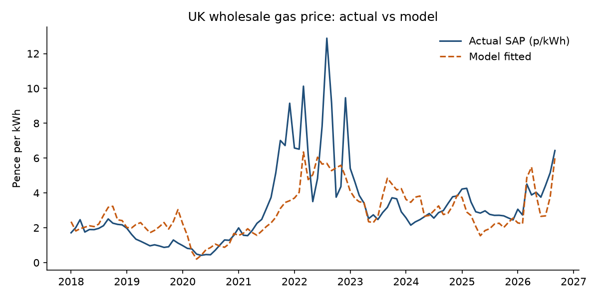
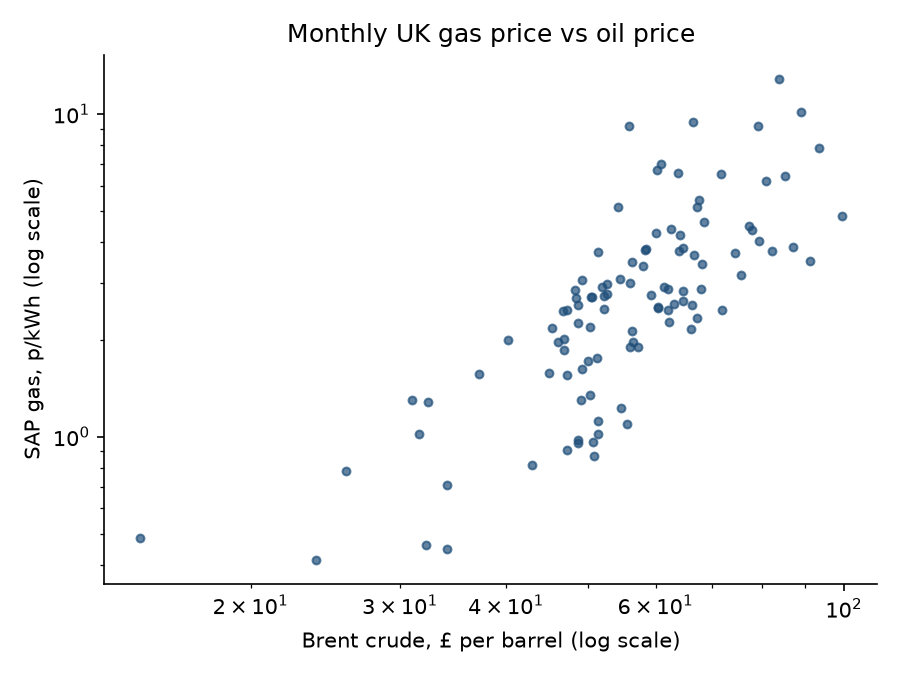
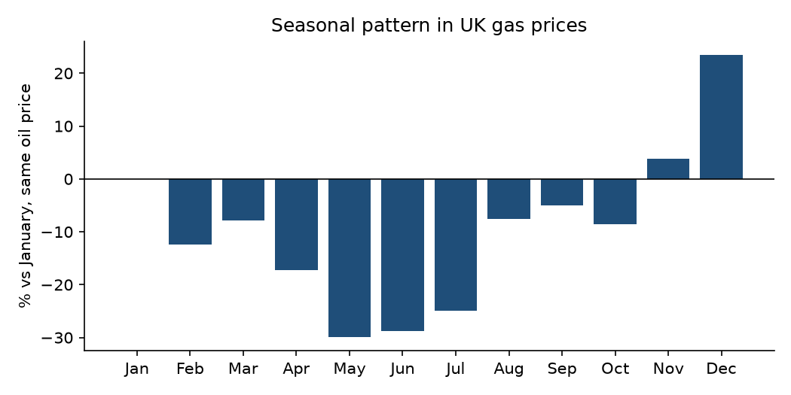
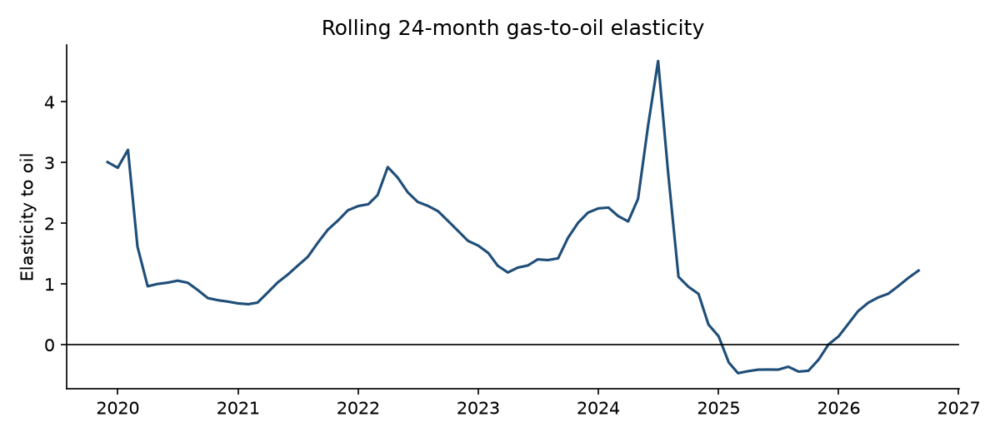

# Results

Monthly data, January 2018 to September 2026 (105 months).

## Headline

- A 1% rise in the oil price (in pounds) is associated with a **1.87%** change in the UK wholesale gas price, holding the time of year fixed (robust t = 10.5).
- Oil price and season together explain **65%** of the month-to-month variation in log gas prices (adjusted R² 0.60).
- Relative to January, prices are highest in Dec and lowest in May at the same oil price.
- The rolling 24-month elasticity ranged from -0.47 to 4.67, so the gas-oil link is not stable over time.

## Largest misses (model residuals)

| Month | Actual p/kWh | Fitted p/kWh | Miss |
|---|---|---|---|
| Dec 2019 | 1.12 | 3.04 | -63% |
| Sep 2019 | 0.87 | 2.30 | -62% |
| Dec 2021 | 9.15 | 3.55 | +157% |
| Apr 2020 | 0.49 | 0.20 | +143% |
| Jan 2020 | 0.97 | 2.23 | -56% |

## Coefficients

| Term | Coefficient | Robust SE | t |
|---|---|---|---|
| const | -6.442 | 0.725 | -8.9 |
| log_brent_gbp | 1.865 | 0.178 | 10.5 |
| month_Feb | -0.133 | 0.193 | -0.7 |
| month_Mar | -0.082 | 0.183 | -0.4 |
| month_Apr | -0.190 | 0.211 | -0.9 |
| month_May | -0.355 | 0.187 | -1.9 |
| month_Jun | -0.339 | 0.191 | -1.8 |
| month_Jul | -0.287 | 0.204 | -1.4 |
| month_Aug | -0.078 | 0.220 | -0.4 |
| month_Sep | -0.051 | 0.222 | -0.2 |
| month_Oct | -0.090 | 0.230 | -0.4 |
| month_Nov | 0.038 | 0.194 | 0.2 |
| month_Dec | 0.211 | 0.255 | 0.8 |

